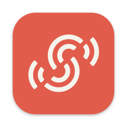

<p align="center">
  
</p>

<h1 align="center">Sendspin for Mac</h1>


<p align="center">Like Airplay, but lossless, fast and open source using <a href="https://www.sendspin-audio.com/">Sendspin</a>.</p>

Sendspin enables wireless, lossless and hi-res music streaming to your speakers. With Sendspin for Mac, wireless and bit-perfect playback is finally possible on your Mac.

The app adds an output device named **Sendspin**, plus a menu bar app to choose speakers and control their volume:


## What you need

A Mac with macOS 14 or later. So far it's only been tested on macOS 27.0.1, on a MacBook Pro with Apple silicon; if you run it on an older macOS or an Intel Mac, please let us know how it goes in [Issues](https://github.com/Sendspin/sendspin-mac/issues).

And speakers or players that speak **Sendspin 1**, the encrypted version of the protocol (still a release candidate in October 2026). Sendspin's own site keeps [the current list](https://www.sendspin-audio.com/#speakers).

- **[Home Assistant Voice Preview Edition](https://www.home-assistant.io/voice-pe/)** ($59). Plugs into any powered speaker, amplifier or receiver (3.5 mm). Needs firmware built on ESPHome 2026.10 or later.
- **[Apollo CAST-1](https://apolloautomation.com/blogs/news/meet-cast-1-audio-casting)** ($30). A small adapter with a PCM5122 DAC for powered speakers, amplifiers and receivers. Runs ESPHome, with the same requirement.
- **Build your own** for under $10: [SendspinZero](https://github.com/RealDeco/SendspinZero), an ESP32-S3 with a DAC board, on ESPHome 2026.10 or later.
- **A Raspberry Pi or any Linux computer** with a DAC or speakers: [the Sendspin daemon](https://github.com/Sendspin/sendspin-cli), from a release built on aiosendspin 10 or later (8.0.0 isn't yet).

### Already running Music Assistant?

Then **Music Assistant** shows up in the menu, below the speakers. Set this Mac up in Music Assistant and enter the code the Mac shows, and Music Assistant can play the Mac's audio on any of its speakers and groups, AirPlay, Chromecast and Sonos included: choose it in the menu, and select this Mac as an input source there. Music Assistant chooses the speakers and the volume, and it isn't in sync with the speakers in the menu, so the Mac plays to one or the other.

## Install

Download the disk image from [Releases](https://github.com/Sendspin/sendspin-mac/releases), open it and drag the app to Applications. On first launch it installs its audio driver (your password once) and asks for local network access. Then click the + on your speakers in the menu bar app: that switches the Mac to Sendspin. The current release is a beta.

## Why not just AirPlay?

If your speakers have AirPlay, it is the easier choice: it's built into every Mac, needs no driver or permissions, and works from your iPhone too. This app is for Sendspin speakers, and if sound quality matters to you, it has a few things going for it:

- **Lossless up to 24-bit/192 kHz.** AirPlay from the Music app or an iPhone is lossy (AAC); only the Mac's system-wide AirPlay output is lossless, and only at 16-bit/44.1 kHz. With Sendspin, every speaker gets PCM or FLAC at the best sample rate and bit depth it supports.
- **No conversion to 44.1 kHz.** Most Mac audio is 48 kHz: video, games, browsers. AirPlay has to resample it; a 48 kHz Sendspin speaker gets it as it is.
- **Bit-perfect.** Measured: test files at 48 and 96 kHz, 16 and 24 bit, over PCM and FLAC, reach the speaker sample for sample. Volume sets the speakers' volume instead of scaling the audio.
- **Every speaker its own format.** A hi-res DAC isn't held back by a 16-bit speaker in the same group.
- **Tight sync, little delay.** Sendspin requires every speaker to stay within ±1 ms of the shared clock. The speaker buffer is what the speakers ask for, and macOS knows it, so video keeps lip sync (measured +0.5 ms on an HA Connect AUX-2).
- **Fast.** AirPlay can feel sluggish when changing volume or skipping a track: the Mac's system-wide AirPlay output runs about 2 s behind. Sendspin is snappy: volume reaches the speakers at once, and a skipped track starts after the speaker buffer, about half a second with an HA Connect AUX-2.
- **Open hardware.** No licence or certification: a Raspberry Pi with a DAC board, an ESP32 build, or a Home Assistant speaker.

Most Sendspin speakers today play 48 kHz/16-bit; for hi-res you need a hi-res player.

## How it fits together

```
apps ─► "Sendspin" output device (Driver/, HAL plug-in)
           │ read back from the driver, same host clock
           ▼
        menu bar app (App/) ── SendspinServerKit (Packages/) ── ws:// ──► speakers
                                         └── ws:// ──► Music Assistant (as a source)
```

| Path | What |
| --- | --- |
| `Driver/` | Audio Server plug-in on libASPL: the output-only Sendspin device, which hands what's played to it to the app, with volume/mute and a reported latency. |
| `Packages/SendspinServerKit/` | Sendspin server, and client with the source role, in Swift (`SendspinServerKit`, also the menu's rules: `SpeakerMenu`); CoreAudio capture and device control (`SendspinAudio`); the menu's rows in SwiftUI (`SendspinMenuUI`); and the `sendspin-bridge` CLI (`--source` makes it a source for Music Assistant). Its `Tests/` holds the unit tests, which `swift test` runs anywhere, CI included: the menu's rules, one test each (`SpeakerMenuTests`), and snapshots of every row state (`RowSnapshotTests`, on a Mac only). |
| `App/` | SwiftUI menu bar app (XcodeGen project). It carries the driver and installs it itself. |
| `Release/` | Builds the disk image; signs and notarizes it for releases. |
| `Tests/` | Tests of the whole system, run by hand on a Mac: the ones that need the installed driver (`device-tests.sh`), and a test player built on aiosendspin (`interop/`). The Swift unit tests are the package's: SwiftPM keeps a test target inside its package. |
| `docs/menu-states.md` | What the menu shows in each situation, what every state means, and the rules behind them. Keep it in step with the menu. |

## Build and run

Requirements: macOS 14+, Xcode 26+, CMake, and [XcodeGen](https://github.com/yonaskolb/XcodeGen).

```sh
cd App && xcodegen generate
xcodebuild -project Sendspin.xcodeproj -scheme Sendspin -derivedDataPath build build
open "build/Build/Products/Debug/Sendspin (Dev).app"
```

The build compiles the driver with CMake and embeds it in the app (`Contents/Library/Audio/Plug-Ins/HAL`). On first launch the welcome window installs it, which restarts coreaudiod (audio drops for a moment), and asks for local network access (to find speakers). When working on the driver alone, `Driver/install.sh` installs a CMake build directly. Each install restarts coreaudiod; after many without a reboot, macOS can keep coreaudiod busy for minutes (driven by AirPlayXPCHelper). A reboot clears it.

Debug builds are a separate app, "Sendspin (Dev)" (`com.sendspin-audio.mac.dev`), with their own settings and permissions, so they don't mix with an installed release. Both use the same driver; don't run them at the same time. A build carrying another driver version offers to install its own (an older release would put its old driver back): decline it there. A dev build run from the build folder can't advertise itself to speakers: mDNSResponder can't read its Info.plist inside your home folder, and refuses the announcement (`NoAuth`). To test client-initiated connections, copy the dev app to /Applications and run it from there.

Local builds are signed ad hoc, so each build is a new app to the Keychain, which asks again for the app's keys. With a signing certificate, create `App/Local.xcconfig` (git ignores it) and the Keychain keeps trusting your builds once you click *Always Allow*:

```
CODE_SIGN_IDENTITY = Developer ID Application: Your Name (TEAMID)
DEVELOPMENT_TEAM = TEAMID
```

### Tests

```sh
swift test --package-path Packages/SendspinServerKit   # unit tests, also run by CI on every push
Driver/tests/run_ring_test.sh                          # the driver's ring buffer (after a CMake build)
Tests/device-tests.sh                                  # needs the installed driver; quit the app first
swift build --package-path Packages/SendspinServerKit --product sendspin-bridge && \
  uv run Tests/interop/test_server.py --bridge Packages/SendspinServerKit/.build/debug/sendspin-bridge
                                                       # the Mac as a source, against scripted servers; also run by CI
uv run Tests/interop/test_client.py --bridge Packages/SendspinServerKit/.build/debug/sendspin-bridge
                                                       # the server side, against scripted players; also run by CI
uv run Tests/interop/test_roles.py --bridge Packages/SendspinServerKit/.build/debug/sendspin-bridge
                                                       # visualizer, artwork, color, metadata, controller; also run by CI
uv run Tests/interop/test_cpp.py --bridge Packages/SendspinServerKit/.build/debug/sendspin-bridge \
  --sendspin-cli PATH                                  # the server side, against sendspin-cpp-cli; also run by CI
```

The device tests check that the driver hands back its audio sample-exact, at the output timestamps apps see, that a sample-rate switch restarts the device's timeline once, that other programs are refused the audio, and that a format switch gives aiosendspin's player exactly one new stream. They switch the device's rate and put it back.

`Tests/interop/test_player.py play` is a player to listen with: it plays on the Mac's speakers at any rate, and announces itself on this Mac only, so the app lists it at once and drops it when it exits (add it to play). It needs [uv](https://docs.astral.sh/uv/).

`Tests/interop/test_server.py` tests the Mac as a source (the client side of the protocol) against scripted servers: aiosendspin's handshakes, then exactly the messages a scenario calls for, including the wrong ones no real server sends, such as an activation the client must refuse after a re-handshake, or two servers activating at the same moment. It runs `sendspin-bridge --source` with a fresh `--config-dir` and `--no-advertise`, so nothing shows up on the network and the app is left alone. `Tests/interop/test_client.py` does the same for the server side, with scripted players that `sendspin-bridge` dials by URL: a malformed handshake, a goodbye to reconnect after, connections that close at once, a re-handshake that's never answered.

`Tests/interop/test_cpp.py` tests the server side against [sendspin-cpp-cli](https://github.com/Sendspin/sendspin-cpp-cli), the reference player, which runs the library ESPHome speakers run: pairing by its dynamic code (after a wrong one), its static code and its token, staying paired and unpairing, refusing to play unpaired unless it allows that, its controller's group volume and mute, its input as a source, and a second server taking it over. `PATH` is its `sendspin-cli` binary, from a release's macOS tarball; CI uses 0.4.0.

`Tests/interop/test_roles.py` tests the roles a speaker with a screen or lights uses against aiosendspin's client, set up as [sendspin-python-cli](https://github.com/Sendspin/sendspin-python-cli)'s terminal player sets it up (its headless daemon offers none of them): visualizer frames ahead of their timestamps, within the rate asked for and with the test tone's frequency, stopping when asked for none; artwork at the channel's size, also after the channel changes; the metadata and color states; and the controller's group volume and mute, round trip.

## Release

Releases are built by GitHub Actions (`.github/workflows/release.yml`). Push a tag `v<version>`, and the workflow builds, signs and notarizes the disk image, then attaches it to a **draft** release. Check the draft and publish it by hand. The version comes from `MARKETING_VERSION` in `App/project.yml` and must match the tag. Raise `DRIVER_VERSION` in `Driver/CMakeLists.txt` only when the driver changes: the app asks users with another driver version to update it, which needs their password.

One-time setup, with a paid Apple Developer membership:
1. On developer.apple.com → Certificates, create a *Developer ID Application* certificate with the **G2 Sub-CA** profile type (the previous sub-CA expires on 1 February 2027). Export the identity as a `.p12`: `security export -t identities -f pkcs12 -P <password> -o developer-id.p12`.
2. App Store Connect → Users and Access → Integrations → Team Keys: create a key with the *Developer* role for notarization. Download the `.p8`, and note its Key ID and the Issuer ID.
3. GitHub → Settings → Environments: create `release`, limited to tags `v*`, with these secrets:

   | Secret | Value |
   | --- | --- |
   | `DEVELOPER_ID_P12` | `base64 -i developer-id.p12` |
   | `P12_PASSWORD` | the `.p12` password |
   | `NOTARY_KEY` | contents of the `.p8` |
   | `NOTARY_KEY_ID`, `NOTARY_ISSUER_ID` | from step 2 |

### Local builds

`Release/build-dmg.sh` builds `build/release/Sendspin-<version>.dmg`; it needs [create-dmg](https://github.com/create-dmg/create-dmg) (`brew install create-dmg`). Without signing variables the app is signed ad hoc: fine on your own Mac, not for distribution. `DEVELOPER_ID_APP` alone signs it without notarizing, which is enough on your own Mac too. To sign and notarize, with the certificate from step 1 in your keychain and a notarytool profile (`xcrun notarytool store-credentials notary --key … --key-id … --issuer …`):

```sh
DEVELOPER_ID_APP="Developer ID Application: <Name> (<TEAMID>)" \
NOTARY_PROFILE=notary \
Release/build-dmg.sh
```

## How it works

- **Connection.** Sendspin 1: every connection is end-to-end encrypted with Noise (`KKpsk2`, ChaChaPoly or AES-GCM, whichever the speaker picks). The app identifies itself with a Curve25519 key kept in the Keychain. Adding a speaker in the menu allows it to play unpaired, bound to the identity it presents then. A paired speaker needs no allowing, and another device under its name, or under the name of one you allowed, shows Identity changed and gets no audio until you click it to accept it. Both ways of connecting work: the app dials speakers that advertise `_sendspin._tcp`, and advertises itself as `_sendspin-server._tcp` (port 8927, or a free one) for speakers that look for a server. Those appear out of the group and wait, with no activities, until you add them; removing one closes its connection, and it comes back out of the group when it reconnects. Connections are pinged every 2 s: a speaker that answers nothing for 6 s shows as Unavailable while in the group, and the app keeps trying until it plays again. The list is what mDNS reports. A speaker that loses power can't say goodbye, and mDNS would keep it for up to 75 minutes, so each one is checked every 15 s: for one that doesn't answer, mDNSResponder is asked to verify its records, which drops it when it's really gone. Its announcement when it's back adds it again straight away.
- **Pairing.** Speakers pair by any of the three ways the spec defines: the pairing token (scanned as its QR code with the Mac's camera, or pasted), a static code, or a dynamic code, whichever the speaker offers, preferring the dynamic code as the implementation guide advises. A dynamic code is typed as digits, or, from a speaker that shows it only as a QR code, scanned with the camera. Ticking a speaker that only plays for paired servers pairs it; Settings lists the speakers on the network that aren't paired, each with Pair…, and pairing there leaves a speaker unticked. Pairing discards its permission to play unpaired. Forget in Settings unpairs it (`server/unpair` when it's connected) and unticks it, so it's a new speaker again. A speaker that no longer recognizes the Mac shows "Needs pairing again".
- **Device.** *Sendspin* is an output only, like a speaker: the app reads what's played to it straight from the driver, sample-exact, so it needs no microphone permission. The driver hands that audio only to this app (and `sendspin-bridge`), going by the kernel's record of their code signatures. Its volume and mute controls aren't applied to the audio: the app forwards them to the speakers, so the volume keys and Control Center control the speakers (with Sendspin speakers chosen; with Music Assistant, its own volume applies).
- **Timing.** Each captured block is scheduled at its capture host time plus the *speaker buffer*: the largest `min_buffer_ms` plus `output_delay_ms` among the ticked speakers, as they report it, plus 50 ms for sending (the Mac's own output needs its latency plus 100 ms). It's raised as soon as a speaker needs more, and lowered only once nothing plays, so unticking a speaker doesn't cut into the music. Capture timestamps equal the output timestamps apps see (`sendspin-bridge --measure-latency` reports 0.00 ms), so the driver reports exactly the buffer as output latency, and video players keep lip sync. Verified acoustically on an HA Connect AUX-2 (`sendspin-bridge --measure-sync`): +0.5 ms. Safari honours it. Firefox reads the latency but doesn't delay video by it, as with Bluetooth headphones. Use Safari or a video-delay extension there.
- **The Mac's own output.** Its speakers, AirPods or a USB DAC play along in sync when added next to a Sendspin speaker, and directly, without the buffer's delay, on their own. Playing along, they're no Sendspin player: the app plays the group's audio on them itself (`LocalPlayer`). The server clock is host time, as are CoreAudio's output timestamps, so there's no clock to synchronize: on the built-in outputs each frame is heard at its render timestamp plus the stream's latency. Not the full latency apps are told (device latency + safety offset + stream): measured acoustically on a MacBook Pro, that played 2.0 ms ahead of an HA Connect AUX-2; the stream latency alone puts them 0.3 ms apart, the sound's way to the mic. The speakers' own clock drifts from host time (about 5 ppm on a MacBook Pro), which single frames dropped or repeated follow, as the player role's suggested strategy does: within a 100 µs dead band, at most 0.5% of the frames, with a one-shot resync at the start, after an underrun, and past 1 ms. Other outputs use the full latency macOS reports (AirPods Pro: in sync by ear), and an output that needs more than the buffer raises it. AirPlay can't play along: macOS only has the device while it's the Mac's output. `sendspin-bridge --local "MacBook Pro Speakers"` does the same from the command line.
- **Format.** The device runs at 44.1–192 kHz in 32-bit float. Settings offers the sample rate and bit depth (16/24) combinations the selected speakers support; picking one switches the device rate and the stream, with one restart of each: a rate switch drops about 150 ms of audio, a bit-depth switch nothing. A speaker that can't take the active format gets the closest one it supports: resampled (96 → 48 kHz, 88.2 → 44.1 kHz) and/or at its own bit depth, with TPDF dither for 16-bit (only on samples that aren't 16-bit values already, so 16-bit sources and silence pass bit-perfect). Each speaker gets PCM or FLAC (20 ms frames, AudioToolbox's encoder), in its own order of preference, as long as our buffer of it fits the speaker's `buffer_capacity`; that limit is also enforced when sending.
- **Idle.** After 3 s of digital silence the speakers get `stream/end`. The stream restarts with the next sound.
- **Volume.** Group volume is the speakers' average. Changing it shifts every speaker equally, so their relative balance is kept (the same algorithm as aiosendspin).
- **Music Assistant.** The app is also a Sendspin client with the `source@v1` role: it advertises `_sendspin._tcp` (port 8928, or a free one) with its own Curve25519 identity, and Music Assistant connects to it. Pairing is by dynamic pairing code: the Mac shows six digits, derived from the Noise handshake and both sides' nonces, and CPace (X25519, SHA-512) proves the operator entered them. The Pairing PSK method, which every client must implement, is for automated pairing between systems: its token (`SP:0…`, the client key and the pairing PSK) isn't shown in the app, since a person never types it (`sendspin-bridge --source` prints it). The Mac offers no static code: a client offers one code method. The long-term keys of up to 5 servers are kept in the Keychain (Settings → Forget unpairs). Clock sync is the Sendspin time filter (a 2D Kalman filter) over bursts of `client/time`. When Music Assistant asks, the Mac streams FLAC at the device's rate in 16 bit, 20 ms chunks stamped with their capture time in the server's clock, and reports `signal: present` while there's sound, so Music Assistant can start it automatically. With Sendspin speakers chosen it sends silence instead: the stream stays open, like a quiet line-in, and resumes when Music Assistant is chosen again.

Hidden settings (`defaults write com.sendspin-audio.mac …`, or `….dev` for a dev build):
- `manualPlayers`: an array of `ws://host:port/path` URLs, for speakers mDNS can't find;
- `verboseLogging`: debug logs on stderr.

## Status

Implements Sendspin 1 (release candidate): as a server, pairing with speakers by token, static or dynamic code (as digits or a QR code), or playing unpaired to speakers you allow; and as a client with the source role, paired by dynamic pairing code (or the pairing token). Tested against aiosendspin 10.2.1, Music Assistant 2.10.7 and an HA Connect AUX-2 (firmware 2026.10.3). The pre-1.0 unencrypted protocol isn't supported. Not yet done: Opus, and a test of 44.1 kHz-only speakers (the resampler should already handle them).
