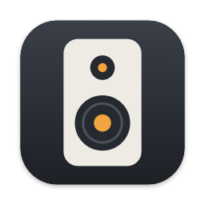
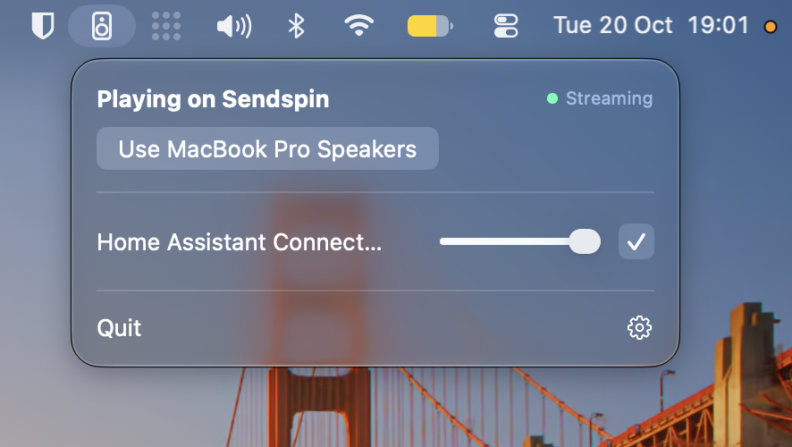

<p align="center">
  
</p>

<h1 align="center">macOS Audio for Sendspin</h1>

<p align="center">Play your Mac's audio on <a href="https://www.sendspin-audio.com/">Sendspin</a> speakers, in sync.</p>

macOS Audio for Sendspin adds an output device named **Sendspin**, plus a menu bar app to
choose speakers and control their volume.



> Sendspin is a protocol of the Open Home Foundation; this project is not affiliated with
> or endorsed by it.

## Install

Download the disk image from [Releases](https://github.com/wildekek/macos-audio-for-sendspin/releases),
open it and drag the app to Applications. On first launch it installs its audio driver (your
password once) and asks for the microphone and local network. Then tick your speakers in the
menu bar app and click **Use Sendspin**. The current release is a beta.

## How it fits together

```
apps ─► "Sendspin" output device (Driver/, HAL plug-in)
           │ loopback, same host clock
           ▼
        menu bar app (App/) ── SendspinServerKit (Packages/) ── ws:// ──► speakers
```

| Path | What |
| --- | --- |
| `Driver/` | Audio Server plug-in on libASPL: the loopback device, with volume/mute and a reported latency. |
| `Packages/SendspinServerKit/` | Sendspin server in Swift (`SendspinServerKit`), CoreAudio capture and device control (`SendspinAudio`), and the `sendspin-bridge` CLI. |
| `App/` | SwiftUI menu bar app (XcodeGen project). It carries the driver and installs it itself. |
| `Release/` | Builds the disk image; signs and notarizes it for releases. |

## Build and run

Requirements: macOS 14+, Xcode 26+, CMake, and [XcodeGen](https://github.com/yonaskolb/XcodeGen).

```sh
cd App && xcodegen generate
xcodebuild -project MacOSAudioForSendspin.xcodeproj -scheme MacOSAudioForSendspin -derivedDataPath build build
open "build/Build/Products/Debug/macOS Audio for Sendspin (Dev).app"
```

The build compiles the driver with CMake and embeds it in the app
(`Contents/Library/Audio/Plug-Ins/HAL`). On first launch the welcome window installs it, which
restarts coreaudiod (audio drops for a moment), and asks for microphone access (to read the
Sendspin device's loopback) and local network access (to find speakers). When working on the
driver alone, `Driver/install.sh` installs a CMake build directly.

Debug builds are a separate app, "macOS Audio for Sendspin (Dev)" (`eu.vooijs.MacOSAudioForSendspin.dev`),
with their own settings and permissions, so they don't mix with an installed release. Both use
the same driver; don't run them at the same time. A dev build run from the build folder can't
advertise itself to speakers: mDNSResponder can't read its Info.plist inside your home folder,
and refuses the announcement (`NoAuth`). To test client-initiated connections, copy the dev
app to /Applications and run it from there.

## Release

Releases are built by GitHub Actions (`.github/workflows/release.yml`). Push a tag `v<version>`,
and the workflow builds, signs and notarizes the disk image, then attaches it to a **draft** release.
Check the draft and publish it by hand. The version comes from `MARKETING_VERSION` in
`App/project.yml` and must match the tag. Raise `DRIVER_VERSION` in `Driver/CMakeLists.txt` only
when the driver changes: the app asks users with another driver version to update it, which needs
their password.

One-time setup, with a paid Apple Developer membership:
1. On developer.apple.com → Certificates, create a *Developer ID Application* certificate with
   the **G2 Sub-CA** profile type (the previous sub-CA expires on 1 February 2027). Export the
   identity as a `.p12`: `security export -t identities -f pkcs12 -P <password> -o developer-id.p12`.
2. App Store Connect → Users and Access → Integrations → Team Keys: create a key with the
   *Developer* role for notarization. Download the `.p8`, and note its Key ID and the Issuer ID.
3. GitHub → Settings → Environments: create `release`, limited to tags `v*`, with these secrets:

   | Secret | Value |
   | --- | --- |
   | `DEVELOPER_ID_P12` | `base64 -i developer-id.p12` |
   | `P12_PASSWORD` | the `.p12` password |
   | `NOTARY_KEY` | contents of the `.p8` |
   | `NOTARY_KEY_ID`, `NOTARY_ISSUER_ID` | from step 2 |

### Local builds

`Release/build-dmg.sh` builds `build/release/macOS-Audio-for-Sendspin-<version>.dmg`; it needs
[create-dmg](https://github.com/create-dmg/create-dmg) (`brew install create-dmg`). Without
signing variables the app is signed ad hoc: fine on your own Mac, not for distribution. To sign
and notarize locally, with the certificate from step 1 in your keychain and a notarytool profile
(`xcrun notarytool store-credentials notary --key … --key-id … --issuer …`):

```sh
DEVELOPER_ID_APP="Developer ID Application: <Name> (<TEAMID>)" \
NOTARY_PROFILE=notary \
Release/build-dmg.sh
```

## How it works

- **Connection.** Sendspin 1: every connection is end-to-end encrypted with Noise
  (`KKpsk2`, ChaChaPoly or AES-GCM, whichever the speaker picks). The app identifies itself
  with a Curve25519 key kept in the Keychain. Speakers are unpaired: ticking one in the menu
  allows it, bound to the identity it presents then, so another device using its name gets
  no audio until you allow it again (untick and tick). Both ways of connecting work: the app
  dials speakers that advertise `_sendspin._tcp`, and advertises itself as
  `_sendspin-server._tcp` (port 8927, or a free one) for speakers that look for a server. Those
  appear unticked and wait, with no activities, until you tick them; unticking one closes its
  connection, and it comes back unticked when it reconnects.
- **Device.** Audio played to *Sendspin* is looped back to the device's input, sample-exact.
  Its volume and mute controls aren't applied to the audio: the app forwards them to the
  speakers, so the volume keys and Control Center control the speakers.
- **Timing.** Each captured block is scheduled at its capture host time plus the *speaker
  buffer* (300 ms / 600 ms / 1 s), or more when a connected speaker asks for it
  (its `min_buffer_ms` plus `output_delay_ms`; Settings then shows why). Capture timestamps equal the output timestamps apps see
  (`sendspin-bridge --measure-latency` reports 0.00 ms), so the driver reports exactly the
  buffer as output latency, and video players keep lip sync.
  Verified acoustically on an HA Connect AUX-2 (`sendspin-bridge --measure-sync`): +0.5 ms.
  Safari honours it. Firefox reads the latency but doesn't delay video by it, as with
  Bluetooth headphones. Use Safari, a smaller buffer, or a video-delay extension there.
- **Format.** The device runs at 44.1–192 kHz in 32-bit float. Settings offers the
  sample rate and bit depth (16/24) combinations the selected speakers support; picking
  one switches the device rate and the stream. A speaker that can't take the active format
  gets the closest one it supports: resampled (96 → 48 kHz, 88.2 → 44.1 kHz) and/or at its
  own bit depth, with TPDF dither for 16-bit. Each speaker gets PCM or FLAC (20 ms frames,
  AudioToolbox's encoder), in its own order of preference, as long as our buffer of it fits
  the speaker's `buffer_capacity`; that limit is also enforced when sending.
- **Idle.** After 3 s of digital silence the speakers get `stream/end`. The stream restarts
  with the next sound.
- **Volume.** Group volume is the speakers' average. Changing it shifts every speaker
  equally, so their relative balance is kept (the same algorithm as aiosendspin).

Hidden settings (`defaults write eu.vooijs.MacOSAudioForSendspin …`, or `….dev` for a dev build):
- `manualPlayers`: an array of `ws://host:port/path` URLs, for speakers mDNS can't find;
- `verboseLogging`: debug logs on stderr.

## Status

Implements Sendspin 1 (release candidate) with unpaired access, tested against aiosendspin
10.2.1 and an HA Connect AUX-2 (firmware 2026.10.2). The pre-1.0 unencrypted protocol isn't
supported. Speakers that only admit paired servers show "Needs pairing". Not yet done:
pairing, Opus, and a test of 44.1 kHz-only speakers (the resampler should already handle them).
